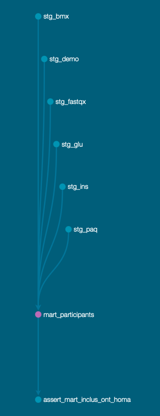

# nutrition_insuline : qualité des données NHANES avec dbt

Projet personnel de **qualité et de documentation des données** (dbt Core + BigQuery + Streamlit) sur les données publiques NHANES (CDC), cycle août 2021 - août 2023 : insuline et glycémie à jeun, mesures corporelles, activité physique déclarée, bilans de laboratoire.

> **Ce projet ne contient aucune analyse médicale, aucune conclusion clinique et aucun conseil de santé.** C'est un projet de qualité de données.

**Dashboard en ligne : https://nutrition-insuline-nn.streamlit.app**

## Problématique

1. **Fiabilité de l'indicateur** : peut-on calculer un indice HOMA-IR fiable à partir de NHANES ? Quelles règles de qualité faut-il appliquer, combien de participants écartent-elles, et ces règles changent-elles les résultats ?
2. **Association descriptive** : une fois l'indicateur construit, à quelles mesures est-il associé dans cet échantillon ?

## Réponse à la problématique

**Un HOMA-IR peut être calculé pour 2 882 adultes**, soit 45,5 % des 6 337 adultes examinés, en appliquant les règles de qualité décrites ci-dessous. Il est exploitable pour une description, mais pas validé au sens strict :

- **Calculable** : la principale cause d'exclusion des adultes est l'insuline ou la glycémie manquante (3 179 sur 3 455 adultes écartés), puis le critère de jeûne (238).
- **Robuste aux règles de jeûne** : exiger 0, 8, 9 ou 12 heures de jeûne fait varier les médianes d'au plus 0,13 ; seul l'effectif change fortement.
- **Cohérent avec d'autres mesures** : il est corrélé à l'IMC, au tour de taille, au HDL, aux triglycérides et à l'hémoglobine glyquée (voir plus bas).
- **Distribution très asymétrique** : médiane 2,42, 99e centile 21,98, maximum 227,24, aucune valeur nulle ou négative. Les analyses utilisent donc des médianes et des quartiles, jamais des moyennes.
- **Mais pas validé contre une mesure de référence**, calculé avec une formule de 1985 non recalibrée pour les dosages actuels, et valable seulement pour cet échantillon (poids de sondage non utilisés).

## Pipeline

```
fichiers .xpt (CDC) -> BigQuery nhanes_raw -> staging (12 vues) -> marts (2 tables) -> dashboard Streamlit
```



| Couche | Contenu |
|---|---|
| `nhanes_raw` | Fichiers chargés tels quels (démographie, mesures corporelles, insuline, glycémie, activité physique, questionnaire de jeûne, lipides, hémoglobine glyquée, hémoglobine, ferritine) |
| `staging` | Renommage, typage, recodage des valeurs spéciales, une vue par table |
| `marts` | `mart_participants` (un participant examiné par ligne, HOMA-IR, motif d'exclusion) et `mart_participants_bilans` (HOMA-IR et mesures de laboratoire) |

## Règles de qualité appliquées

- **Valeurs "refus" et "ne sait pas"** recodées en vide (éducation : 7 et 9 ; activité physique : 7777 et 9999), avec un indicateur booléen pour garder la trace.
- **Zéros mal lus** : après lecture des fichiers XPT avec pandas, des valeurs de l'ordre de 5e-79 apparaissaient à la place de 0 (heures et minutes de jeûne, code de limite de détection). La macro `clean_zero` les corrige en staging ; la table brute reste intacte. Un test dbt vérifie qu'il n'en reste aucun.
- **Critère de jeûne officiel du CDC** : 8 heures à moins de 24 heures.
- **Adultes uniquement** (18 ans et plus).
- **Grossesse** : les femmes enceintes et les cas indéterminés sont exclus.
- **Plausibilité** : bornes volontairement larges sur les mesures corporelles et de laboratoire, et cohérence de l'IMC avec le poids et la taille.
- **Cohérence fréquence / unité** (activité physique) : une fréquence positive a toujours une unité, une fréquence nulle n'en a jamais.
- **58 tests dbt** (clés, liens entre tables, valeurs autorisées, tests de cohérence écrits sur mesure), tous au vert.

## Résultat de la sélection

8 860 participants ont été examinés (sur 11 933). Chacun est classé par le **premier** motif d'exclusion rencontré :

| Motif | Participants |
|---|---|
| Insuline ou glycémie manquante | 3 179 |
| Moins de 18 ans | 2 523 |
| Jeûne hors 8 h à moins de 24 h | 238 |
| Grossesse ou statut indéterminé | 36 |
| Durée de jeûne inconnue | 2 |
| **Retenus pour le HOMA-IR** | **2 882** |

## Les règles de qualité changent-elles les résultats ?

On a refait la comparaison du HOMA-IR médian par catégorie d'IMC en variant la durée de jeûne minimale exigée (0, 8, 9 et 12 heures). Les médianes varient d'au plus 0,13, tandis que les effectifs passent de 2 852 (8 h) à 1 976 (12 h) : le choix du seuil modifie surtout la taille de l'échantillon, peu les médianes.

## Associations observées (descriptif, sans causalité)

**Corrélation de rangs avec le HOMA-IR** (de -1 à +1 ; proche de 0 : pas de lien net) :

| Mesure | Femmes | Hommes |
|---|---|---|
| Tour de taille | 0,62 | 0,63 |
| IMC | 0,60 | 0,62 |
| HDL | -0,45 | -0,43 |
| Triglycérides | 0,44 | 0,44 |
| Hémoglobine glyquée | 0,41 | 0,41 |
| Hémoglobine | 0,10 | 0,05 |
| Cholestérol total | -0,09 | -0,05 |
| LDL | -0,05 | -0,05 |
| Ferritine | 0,08 (n = 632, 18 à 49 ans) | aucune valeur |

Médiane du HOMA-IR selon les groupes (du plus bas au plus haut niveau) :

- **IMC** : de 1,37 (IMC 18,5 à < 25) à 3,82 (IMC ≥ 30).
- **Activité de loisir déclarée** : médiane plus basse chez les plus actifs (2,08) que chez ceux qui déclarent aucune activité (2,77), mais l'écart se réduit nettement à IMC comparable.
- **Mesures de laboratoire** : le HOMA-IR médian est plus bas dans les groupes à HDL élevé et plus haut dans les groupes à triglycérides et hémoglobine glyquée élevés. Cholestérol total, LDL, hémoglobine et ferritine montrent peu ou pas de lien.

Ces résultats sont des associations dans cet échantillon, sans test statistique. Les facteurs sont liés entre eux, et l'hémoglobine glyquée et le HOMA-IR reposent tous deux sur la glycémie : leur lien est en partie attendu.

## Dashboard

Application Streamlit en ligne, alimentée par des CSV **agrégés** (aucune ligne individuelle n'est publiée) :

- page principale : qualité des données, facteurs associés, limites ;
- page « Mesures de laboratoire » : corrélations, quartiles et robustesse des règles de qualité ;
- page « Matrice de correlation » : une matrice pour les femmes et une pour les hommes, avec un filtre par tranches d'âge.

## HOMA-IR

`glycémie à jeun (mg/dL) x insuline à jeun (uU/mL) / 405`, soit l'approximation courante de la formule d'origine (glycémie en mmol/L x insuline / 22,5), avec la glycémie convertie en mg/dL. Le CDC ne fournit pas de formule dans la documentation du fichier insuline.

## Limites

- Les chiffres décrivent **cet échantillon**, pas la population américaine : les poids de sondage sont conservés dans les tables mais ne sont pas utilisés.
- Les participants hors critère de jeûne officiel mais avec une insuline mesurée ne sont pas repondérés.
- Les données ne suivent pas les mêmes personnes dans le temps : elles ne montrent ni ce qui augmente ni ce qui améliore le HOMA-IR.
- La cohérence avec d'autres mesures n'est pas une validation contre une mesure de référence.
- Les seuils de plausibilité, les catégories d'IMC, les tranches d'âge et les quartiles sont des choix du projet, pas des normes.
- L'approximation du HOMA-IR utilisée ici date de 1985 et n'est pas recalibrée pour les dosages d'insuline actuels (une version HOMA2 existe).
- Le HOMA-IR est très asymétrique (maximum 227,24). Les cinq valeurs les plus hautes (162 à 227) viennent d'insulines très élevées (252 à 551 uU/mL) avec une glycémie de 132 à 307 mg/dL. Le minimum (0,07) vient de l'unique insuline sous la limite de détection, dont la valeur est imputée. Ces cas sont conservés et signalés, sans correction.
- L'activité physique est celle de loisir, déclarée.
- Unités des mesures de laboratoire, confirmées dans les codebooks du CDC : HDL, cholestérol total, triglycérides et LDL en mg/dL ; hémoglobine glyquée en % ; hémoglobine en g/dL ; ferritine en ng/mL. Le LDL est celui de la méthode de Friedewald (le fichier en propose deux autres).
- 15 adultes retenus ont un LDL inférieur à 30 mg/dL, sans lien avec des triglycérides très élevés ; ils sont conservés et signalés, sans correction.
- La ferritine n'est mesurée que chez des femmes de 18 à 49 ans dans cet échantillon (632 femmes retenues, aucun homme) : sa corrélation ne vaut que pour cette tranche d'âge. La raison du ciblage n'est pas documentée ici.
- Pistes non réalisées : alimentation (rappel de 24 h du jour 1), intervalles de confiance, modèle multivarié, poids de sondage.

## Reproduire

1. Compte Google Cloud, projet avec BigQuery, `gcloud auth application-default login`.
2. `pip install dbt-bigquery pandas pyarrow` (Python 3.11).
3. Télécharger depuis le CDC (suffixe `_L`, cycle 2021-2023) les fichiers listés dans `scripts/load_nhanes.py`, dans `data/raw/`.
4. Adapter `PROJECT` dans `scripts/load_nhanes.py`, puis `python scripts/load_nhanes.py`.
5. Copier `profiles.yml.example` en `profiles.yml` (en mettant votre projet GCP).
6. `export DBT_PROFILES_DIR=. && dbt run && dbt test`.
7. `dbt docs generate && dbt docs serve`.
8. `python scripts/export_dashboard_data.py`, puis `python scripts/export_correlation_matrix.py`, puis `streamlit run dashboard/app.py`.

## Source des données

NHANES, National Center for Health Statistics, CDC. Données publiques.

## Références

- Matthews DR, Hosker JP, Rudenski AS, Naylor BA, Treacher DF, Turner RC. Homeostasis model assessment: insulin resistance and β-cell function from fasting plasma glucose and insulin concentrations in man. Diabetologia. 1985;28(7):412-419. https://doi.org/10.1007/BF00280883